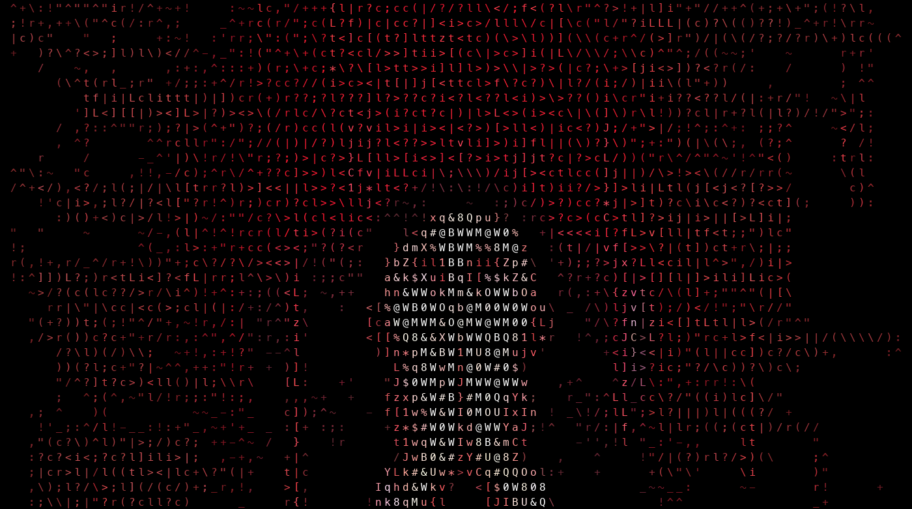
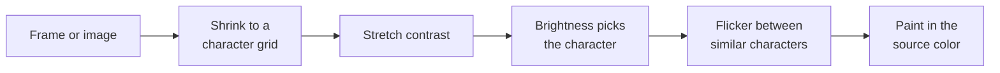

<div align="center">



# `> ascii-converter_`

**Turn any video or image into detailed, full-color ASCII art, with characters that flicker like the Matrix.**


</div>

```text
 `.-'_~,:!^+"r;/\()c?l|><it][Lfjzv}{J*xC1YInuoahw%Zk$Xbdpqm#UO&8QB0@MW
^ dark                                                        bright ^
```

## What it does

- **Video → `.mp4`**, with the original audio
- **Image → `.png`**, from PNG, JPG, WebP, BMP or TIFF
- **Real color**: every character takes its color from the source
- **Matrix flicker**: characters keep swapping for look-alikes of similar density, so the picture stays readable
- **Auto contrast**: dark footage stays visible
- **One Python file**: no web app, no uploads

## Install

```bash
git clone https://github.com/xandra-X/ascii-converter.git
cd ascii-converter
pip install opencv-python numpy pillow
```

Optional: install [ffmpeg](https://ffmpeg.org/) to keep the audio and get H.264 video. Without it, videos are saved silent.

## Use

```bash
python3 ascii_video.py              # opens a file picker
python3 ascii_video.py clip.mp4     # -> clip_ascii.mp4
python3 ascii_video.py photo.jpg    # -> photo_ascii.png
```

## Tune the look

| Option | Default | What it changes |
| --- | :---: | --- |
| `--cols` | `100` | Characters per row. Lower means bigger characters, higher means more detail |
| `--font-size` | `16` | Character size in pixels. Also sets the output resolution |
| `--spacing` | `4` | Empty pixels between characters |
| `--gamma` | `0.8` | Below 1 is brighter and fuller, above 1 is darker and sparser |
| `--flicker` | `0.15` | Share of characters that change each frame, from 0 to 1 (video only) |
| `--classic` | off | No randomness: characters follow brightness only |
| `-o` | `<input>_ascii` | Output file name |

Some recipes:

```bash
python3 ascii_video.py clip.mp4 --cols 60 --spacing 6      # big and airy
python3 ascii_video.py clip.mp4 --cols 180 --font-size 10  # fine detail
python3 ascii_video.py clip.mp4 --flicker 0.4              # full Matrix chaos
python3 ascii_video.py photo.jpg --classic                 # clean and steady
```

## How it works



The 70 characters are sorted by how much ink each one really uses in your font, so the brightness ramp is measured rather than guessed.

## Test

```bash
python3 test_ascii_video.py
```

## Limits

- HEIC photos aren't supported. Export them as JPG first.
- High `--cols` and `--font-size` values make large frames, slow renders and big files.
